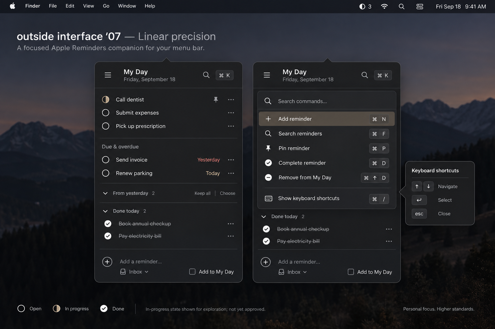
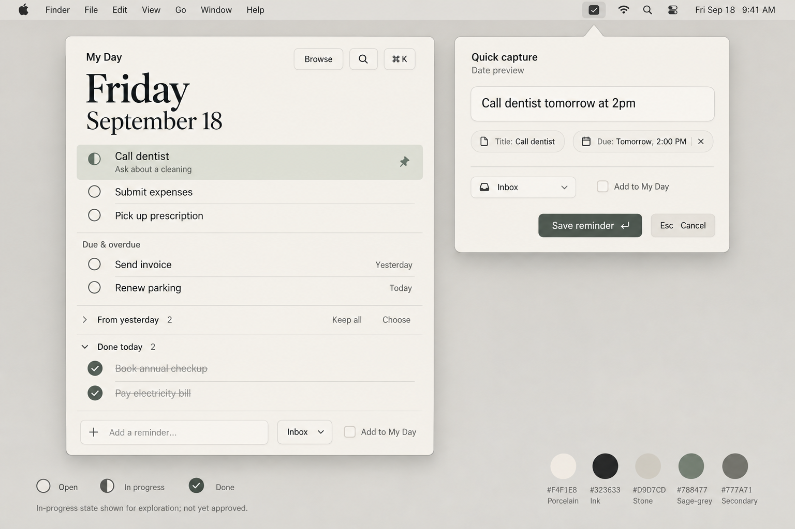
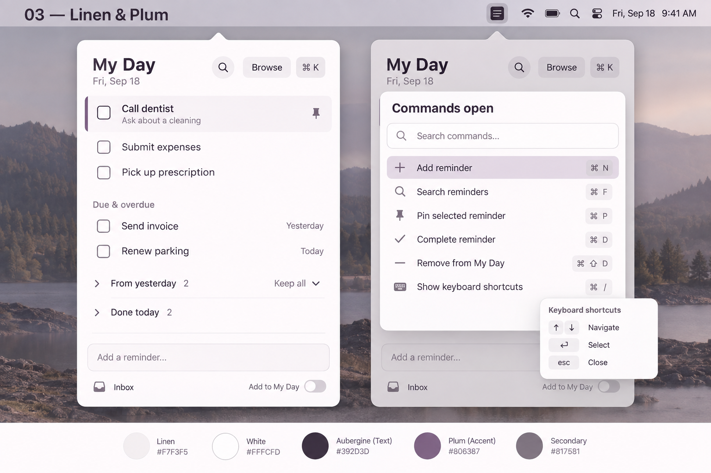

# Daywell visual style guide

Status: layout and theme directions approved September 18, 2026.
Exact metrics below are proposed starting tokens, not pixel-level user approvals.
Generated images are design references, not runnable UI or behavior-verification evidence.

## Primary reference: Linear Precision

Use its compact, predictable rows; aligned status-icon column; restrained date;
subtle separators; secondary metadata; trailing contextual actions; and keyboard
command palette with shortcut help. Keep the native menu-bar utility scale.
Do not add a desktop-project sidebar or a grid of cards.

The hierarchy is My Day commitments (one optional pin), Due & overdue,
From yesterday, Done today, and a separate capture control. Completed rows use
subdued but readable text and strikethrough. Done today is collapsed by default;
the reference expands it to demonstrate completion styling.

## Themes

### Graphite & Taupe — default

- Background: `#242527`
- Raised surface: `#2D2F32`
- Primary text: `#E8E7E3`
- Secondary text: `#AAACAE`
- Accent: `#B6A48F`

### Porcelain & Sage

- Background: `#F4F1E8`
- Raised surface: `#E9E8DF`
- Primary text: `#323633`
- Separator/stone: `#D9D7CD`
- Accent: `#52654F`
- Secondary text: `#64685F`

Borrow colors, not the oversized serif date or alternate layout.

### Linen & Plum

- Background: `#F7F3F5`
- Raised surface: `#EBE4EC`
- Primary text: `#392D3D`
- Accent: `#795C80`
- Secondary text: `#6F6373`

Borrow colors, not the roomier row geometry or rounded-heading treatment.

These are the implemented tokens, adjusted from the generated reference palettes
for text contrast. Keyboard selection uses a full-opacity accent outline, separate
from the pin symbol. Normal primary/secondary/accent text is checked against both
background and raised surfaces; disabled states and native controls still require
the complete accessibility acceptance pass. Aim for at least 4.5:1 normal text and
3:1 meaningful non-text controls; do not infer whole-app compliance from token ratios.

## Typography and geometry

Starting proposal: system SF Pro; 14-point task text, 12–13-point secondary labels,
20-point semibold My Day heading. Use proportional body text and native keycaps.
No oversized editorial heading in the approved layout.

Start with a roughly 400-point-wide popover, 36-point single-line task rows,
16-point side padding, and 16-point status symbols. Allow multiline content and
scrolling within available screen height. Keep capture reachable when lists grow.
Validate these dimensions in a real rendered panel rather than copying image pixels.

## Circle and pin grammar

- **Open:** thin empty ring. Actual v1 reminder completion state.
- **Done:** filled circle containing a contrasting check. Actual v1 completion state.
- **Pinned:** independent pin symbol and restrained row emphasis. At most one current pin.
- **In progress:** half-filled circle, **reserved only**. No v1 control, command,
  domain state, stored field, or menu-bar indicator may imply it is implemented.

Shape carries meaning independently of color. Accessibility labels must expose
completion and pinning separately. A pinned task can be completed without ever
passing through an in-progress state.

## Interaction styling

- Distinguish keyboard focus from pinned emphasis; they are not interchangeable.
- Keyboard selection is visible in every theme and never only a subtle text-color change.
- Context actions appear on keyboard focus as well as pointer hover.
- Search and capture remain separate. Show removable/editable date interpretation
  before saving natural-language input.
- Command palette actions show relevant shortcuts; shortcut help is itself keyboard-accessible.
- Neutral menu-bar icon by default; optional unfinished My Day count is plain,
  subdued text rather than a red notification badge.
- No animated encouragement, streaks, scores, urgency colors for ordinary overdue work,
  or timers. Respect reduced motion.

## Corrections to generated references

- Replace reference 7's half-filled reminder circle with an open circle in v1;
  retain the separate pin. Use a neutral app glyph in the menu bar.
- Do not copy its red overdue date. Use readable, neutral secondary text.
- Generated shortcut bindings are illustrative and inconsistent between images;
  the implementation must define one reviewed command registry.
- From yesterday's collapsed disclosure points right, not down as drawn in 7.
- Remove marketing copy, reference-sheet labels, and generated text errors.
- Removing from My Day means removing a commitment, never deleting a reminder;
  use a minus/removal symbol, not a trash icon.

## Required rendered review

Inspect all three themes with keyboard focus, pinned and unpinned tasks, long titles,
empty My Day, overdue items, yesterday reset, expanded Done today, command palette,
shortcut help, natural-language preview, and permission/error states. Capture and
inspect real screenshots when the app exists. These mockups do not satisfy that check.
